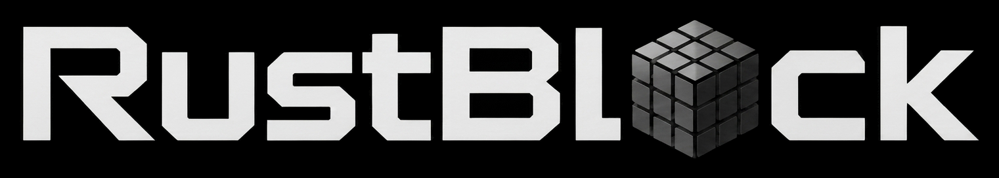

# RustBlock

<p align="center"></p>

**The native Swiss Army knife for GGUF models.** Reblock Prism ternary files, convert floats, quantize, verify and download from Hugging Face or ModelScope — from one steel-and-blocks desktop app. No Python, Node.js or terminal knowledge required.

RustBlock opens the source **read-only**, writes to a temporary file in the destination folder, verifies the result, and only then renames it into place. There is no telemetry and no upload of model data.

Conversion is **multicore and memory-bounded**: independent tensors run in parallel, and a single large tensor is split into codec-aligned spans that are decoded, quantized and re-encoded across all available cores without loading the whole model into RAM.

## What it can do

| Target | What it produces | Lossless? | Best for |
|---|---|---:|---|
| **Reblock** | Prism `PQ2_0` → standard `Q2_0` | **Yes** | Prism Ternary Bonsai files that stock llama.cpp / LM Studio cannot load |
| **F32** | 32-bit float | Yes, from float sources | Maximum compatibility and precision; very large |
| **F16** | 16-bit float | Yes, from F16 | The usual source for quantization; ~2 bytes per weight |
| **BF16** | bfloat16 | Yes, from float sources | Runtimes/training setups that prefer bfloat16 |
| **Q8_0** | 8-bit block quant | No, lossy | Near-original quality, much smaller than F16 |
| **Q5_0** | 5-bit block quant | No, lossy | Middle ground between Q8_0 and Q4_0 |
| **Q5_1** | 5-bit block quant with stored minimum | No, lossy | Older runtime compatibility |
| **Q4_0** | 4-bit block quant | No, lossy | Small and fast; classic legacy quant |
| **Q4_1** | 4-bit block quant with stored minimum | No, lossy | Slightly better than Q4_0 at a similar size |
| **Q2_K** | Mixed 2-bit K-quant preset | No, lossy | Very tight memory; noticeable quality loss |
| **Q3_K_S** | Uniform 3-bit K-quant | No, lossy | Compromise when Q4_K does not fit |
| **Q3_K_M** | Mixed 3-bit K-quant preset | No, lossy | Better quality than Q3_K_S at a slightly larger size |
| **Q4_K_S** | Uniform 4-bit K-quant | No, lossy | A uniform 4-bit baseline |
| **Q4_K_M** | Mixed 4-bit K-quant preset | No, lossy | The usual quality/size sweet spot |
| **Q5_K_S** | Uniform 5-bit K-quant | No, lossy | Better quality than Q4_K_S at a larger size |
| **Q5_K_M** | Mixed 5-bit K-quant preset | No, lossy | Better quality than Q4_K_M at a larger size |
| **Q6_K** | 6-bit K-quant | No, lossy | Near-F16 quality at a smaller size |
| **TQ1_0** | Ternary 1.69-bit | No, lossy | Tiny ternary models; experimental |
| **TQ2_0** | Ternary 2.06-bit | No, lossy | Tiny ternary models; experimental |
| **MXFP4** | 4-bit block float | No, lossy | Recent small/MoE runtimes; experimental |
| **NVFP4** | NVIDIA 4-bit block float | No, lossy | Recent NVIDIA runtimes; experimental |
| **Q1_0** | 1-bit | No, lossy | Extreme compression; experimental |

The K-quant targets use **llama.cpp-compatible mixed recipes**. `Q4_K_M` and `Q5_K_M` promote attention values and `ffn_down` on the first/last eighth and every third tensor, exactly like `llama-quantize`; `Q3_K_M` uses the early-layer bumps; `Q2_K` uses the GQA-aware value rule. Output and tied embeddings use `Q6_K`. The `_S` targets stay uniform like `llama-quantize`: only the output tensor (and a tied token embedding) moves to `Q6_K`, and `Q4_K_S` promotes the first four attention-value tensors to `Q5_K`. Norms, MoE routers, SSM/hybrid state tensors and other non-quantizable tensors keep their source type. This is a recipe engine, not an importance-matrix calibration. IQ formats can be read as sources, but writing them requires an importance matrix and is intentionally not offered.

Ternary, MXFP4, NVFP4 and Q1_0 are **real native targets**, not placeholders: the output is a valid GGUF that the matching runtime can load. They are extremely lossy on a dense model. TQ1_0/TQ2_0 are meant for models trained or distilled for ternary weights; MXFP4/NVFP4 need a recent runtime; Q1_0 is a last-resort size experiment. Use `Full` verification when you want RustBlock to decode the output again and compare it.

### Lossless reblocking

Prism ML publishes Ternary Bonsai GGUFs in two layouts:

| Format | Type id | Block | Bytes / block | Support |
|---|---:|---:|---:|---|
| `PQ2_0` | 142 | 128 elems | 34 | Prism fork only |
| `Q2_0` | 42 | 64 elems | 18 | upstream llama.cpp / LM Studio |

Both use the same 2-bit ternary codec. RustBlock splits each 128-value block into two 64-value blocks with the original scale: no dequantization and no requantization, so every represented value is **bit-identical**.

## GUI


- **Convert** view: drag & drop one or many `.gguf` files, or browse with the native file picker.
- Choose any of the 22 targets with hover descriptions. Every format is visible at once in a three-column grid — no collapsed “More formats” drawer. Float, legacy block, uniform and mixed K-quant, FP4 and 1-bit are grouped in the normal grid; **TQ1_0/TQ2_0 have their own ternary section** with a separate warning because ternary is a different use case, not a normal requant.
- Compact queue with live speed/ETA, per-file progress, **stop after the current file** and per-file removal.
- **Fit at a glance.** Each queued file shows a green/yellow/red RAM/VRAM verdict at 4096 tokens; hover for weights, KV cache and overhead. **Suggest a format** runs the budget planner on the largest queued model and keeps lossless Reblock for PQ2_0.
- Output next to each input or in a custom folder, with overwrite protection and duplicate-path checks.
- Choose `Off`, `Structure` or `Full` verification per batch; `Structure` is the default. The CLI exposes the same `--verify none|structure|full` levels for scripted checks.
- **Discover** view: opens on the most downloaded GGUF repositories, then search Hugging Face, paste a full `huggingface.co/author/model` link, sort by downloads, likes or update time, and open a repository to see its downloadable GGUF files and sizes. A source switch adds **ModelScope**: it has no public search endpoint, so paste a `modelscope.cn/models/owner/name` link (or `owner/name`) and its files are listed through the official repository API. Every file row shows a fit verdict computed **before the download** from the published weight size plus 512 MiB of runtime overhead; the tooltip states that the KV cache is not included because it needs the model header.
- **Download list.** Every request enters a queue in the Discover rail; one transfer runs at a time so browsing stays responsive. Each card shows byte counts, percentage, smoothed speed, the source and repository, with Cancel, Dismiss and Clear finished. A finished file can be added to Convert, opened, inspected or deployed; automatic queueing can be turned off in Settings. Downloads are resumable `.part` files, and **Clean partials** removes interrupted ones.
- Files whose names indicate an existing quantization (`Q4_K_M`, `Q8_0`, `IQ…`, `TQ…`, `MXFP4`, …) are marked **already quantized** before download. After conversion starts, the tensor types are checked as well. Converting a quantized model to another quantized format requires a confirmation, because it compounds the loss; a virgin F16/BF16 release is the better source.
- **Supported standalone GGUF models can be downloaded.** Non-GGUF files are hidden; importance matrices, adapters, split shards and PTQ1_0 containers are rejected. Vision projectors can be downloaded next to their model but never enter the conversion queue. The download function repeats the check before the network request, then re-opens the finished file, verifies its tensor types and deletes it if the native engine cannot decode it. Files already present are shown as cached and can be added to the queue with one click.
- **Built with iced 0.14** (Elm architecture, no retained widget tree): state, messages and effects are separate from rendering, and the view is a pure function of the state.
- **Frameless custom chrome.** The supplied wordmark image is the only branding in the title bar — no text lockup and no second logo. Minimize, maximize/restore and close are canvas-drawn controls inside the app; the maximize icon switches to a restore icon, closing while a job is running asks for confirmation, and the window can be dragged from the wordmark and resized from its eight-pixel edges and corners. Double-click the wordmark to maximize. A faint wordmark remains as the content backdrop.
- **Settings.** Persisted in `%APPDATA%\RustBlock\settings.json`: conversion confirmation and automatic queueing of finished downloads, download folder, model source, Hugging Face endpoint (use `https://hf-mirror.com` when the Hub is blocked), and the LM Studio, Jan and Prism/llama.cpp model folders. Reset defaults is one click away.
- **Test in a runtime.** Any finished model can be registered in **Ollama** through a generated Modelfile and `ollama create`, or copied into the **LM Studio**, **Jan** or **Prism/llama.cpp** model folder; Jan also receives a `model.yml`. The dialog shows whether each target is actually available, copies run on a worker with progress and can be cancelled.
- **Inspector.** Open a local `.gguf` with the native picker or paste its path. It shows header facts, metadata, the tensor type histogram with byte sizes and a memory estimate; a failed read explains why instead of leaving the tab blank.
- The interface is deliberately minimal: dark graphite, neutral steel and square controls, with one action per view. The log panel is collapsed by default and opens with `Ctrl+L` or the Log button; it keeps the last 500 entries.

Network access is used **only** when you search or download from a model source. Local conversion works offline.

### Multicore conversion

RustBlock uses every available logical core by default. Set `RUSTBLOCK_THREADS` to leave headroom for inference or to benchmark:

```bash
RUSTBLOCK_THREADS=8 rustblock convert model-f32.gguf model-q5_k.gguf --to q5_k
```

The worker batch has a bounded memory budget (about 768 MiB of estimated peak buffers), so concurrency does not scale RAM with model size. Encoding and positional writes run in the same parallel batch, and a single tensor is split into enough block-aligned spans to keep every worker busy. On the development machine, a 128 MiB single-tensor F32 → Q5_K conversion took about **0.36–0.40 s with 1 thread** and **0.09–0.10 s with 16 threads** (≈4×; measurements vary with disk cache and CPU).

### Hugging Face token

Public repositories work without a token. For gated or private repositories, set a read token before launching:

```bash
export HF_TOKEN=hf_...
# Windows PowerShell: $env:HF_TOKEN = "hf_..."
```

The token is read from the environment and is never written to disk by RustBlock.

## Install / build

Requires Rust **1.92+**.

```bash
cargo build --release
```

Binaries:

- CLI: `target/release/rustblock` (`rustblock.exe` on Windows)
- GUI: `target/release/rustblock-gui` (`rustblock-gui.exe` on Windows)

Launch the GUI with one or more models:

```bash
cargo run -p rustblock-gui --release -- model-PQ2_0.gguf
```

## CLI

Inspect a GGUF (metadata, tensor histogram, reblock and native-conversion eligibility):

```bash
rustblock inspect model.gguf
```

Verify without writing anything:

```bash
rustblock verify model.gguf            # full PQ2_0 check when applicable
rustblock verify model.gguf --quick    # structure only
```

Convert with the lossless default:

```bash
rustblock convert model-PQ2_0.gguf model-Q2_0.gguf
```

Convert to another target:

```bash
rustblock convert model-F16.gguf model-Q4_K_M.gguf --to q4_k_m --verify structure
```

`--to` accepts:

```text
reblock | f32 | f16 | bf16 | q8_0 | q5_0 | q5_1 | q4_0 | q4_1 |
q2_k | q3_k | q3_k_m | q3_k_s | q4_k | q4_k_m | q4_k_s |
q5_k | q5_k_m | q5_k_s | q6_k | tq1_0 | tq2_0 | mxfp4 | nvfp4 | q1_0
```

`q3_k`, `q4_k` and `q5_k` are aliases for the mixed `_M` presets, matching llama.cpp. Use the explicit `_S` names for uniform output.

Per-tensor rules and the effective map:

```text
--tensor-type REGEX=TYPE       repeatable override, e.g. attn_v=q5_k
--tensor-type-file FILE        import REGEX=TYPE lines; # starts a comment
--dump-tensor-types FILE       write the effective map, importable again
--allow-requantize             permit already-quantized -> quantized output
```

An explicit override is applied before the preset, and the first matching rule wins. Shape-incompatible choices fall back like llama.cpp (for example `Q4_K` -> `Q5_0` and `Q6_K` -> `Q8_0`). Without `--allow-requantize`, converting an already-quantized source to a different quantized type is refused rather than done silently.

Other options:

```text
--force             overwrite an existing output file
--dry-run           validate and estimate without writing
--verify <level>    none | structure | full   (default: structure)
--json              machine-readable output
```

`reblock` is the default so existing scripts keep working. It is only valid for PQ2_0 sources; other targets work from any GGUF whose tensor types the native codec supports.

Choose a target for a memory budget, or record/compare KL divergence with `llama-perplexity`:

```bash
rustblock budget model-F16.gguf --budget-gb 8 --context 4096
rustblock budget model-F16.gguf --budget-gb 8 --output model-Q4_K_M.gguf
rustblock kld model-Q4_K_M.gguf calibration.txt --base reference.kld
rustblock kld model-F16.gguf calibration.txt --record reference.kld
```

Split/merge use a sidecar manifest and header so a split followed by merge is verified against the original SHA-256:

```bash
rustblock split model.gguf parts/ --max-size-mib 4096
rustblock merge parts/model-*.gguf restored.gguf
rustblock hash restored.gguf --expected <sha256>
rustblock meta model.gguf --validate
```

`meta --validate` compiles the Jinja chat template with minijinja (including block/expression syntax) and checks the rope/scaling parameters before a model is shipped. It does not execute the template with a real conversation or validate the rope pairs against a runtime.

To execute the template with an explicit JSON context (the same shape a runtime receives):

```bash
rustblock meta model.gguf --render-template context.json
rustblock meta model.gguf --render-template context.json --json
```

`context.json` must be a JSON object, for example `{"messages":[{"role":"user","content":"Hello"}],"add_generation_prompt":true}`. The rendered text is printed as-is unless `--json` is used. Rope-pair validation against a live runtime remains an external integration check.

Quantized Hugging Face checkpoints can be dequantized natively to BF16 safetensors before using the Python GGUF bridge. FP8 (`F8_E4M3`, `F8_E4M3FN`, `F8_E5M2`) and AutoAWQ 4-bit GEMM tensors are supported; AWQ matrices are transposed to the Hugging Face `[out_features, in_features]` layout, and the command does not invent model architecture metadata:

```bash
rustblock dequant-safetensors model.safetensors model-bf16.safetensors
rustblock from-safetensors model-dir/ model.gguf --native
rustblock from-safetensors model-dir/ model.gguf --script /path/to/convert_hf_to_gguf.py
```

`--native` converts LLaMA, Mistral, Mixtral, Qwen2 and Qwen3 checkpoints directly to an unquantized GGUF. It handles dense and MoE layouts (per-expert and Transformers 5 fused expert tensors), reads `tokenizer.json` (BPE) or SentencePiece `tokenizer.model`, applies the official `[PAD<id>]` vocabulary padding, and preserves Q/K/V biases. FP8 `F8_E4M3`/`F8_E4M3FN`/`F8_E5M2` and AutoAWQ 4-bit sources are dequantized during conversion. Plain weights are streamed one tensor at a time; 1-D tensors are written as F32 and matrices as F16 for runtime compatibility. Other Hugging Face architectures must use the Python bridge or fail explicitly.

Inspect or trim the model cache:

```bash
rustblock cache ~/Downloads/RustBlock --quota-gib 50 --dry-run --json
rustblock cache ~/Downloads/RustBlock --quota-gib 50
```

For headless download progress, `--events` emits one JSON object per line instead of a single final report:

```bash
rustblock download https://example/models/model.gguf model.gguf --events
rustblock download-many jobs.txt --events
```

Events are `start`, `progress`, `done`, `error` and, for a batch, `summary`; each batch event carries the job `index`. Batch progress is throttled to whole percentages so the stream stays bounded.

## Supported sources and limits

- GGUF **v3** files with `F32`, `F16`, `BF16`, `Q4_0`, `Q5_0`, `Q8_0`, K-quants, `Q2_0` and Prism `PQ2_0` tensors.
- `PTQ1_0` is rejected: it has no lossless upstream equivalent, and silent requantization would be misleading.
- Unknown tensor types are rejected rather than guessed.
- **Native safetensors → GGUF covers LLaMA, Mistral, Mixtral, Qwen2 and Qwen3 dense/MoE checkpoints with BPE or SentencePiece tokenizers, including direct FP8/AWQ sources.** It does not cover every Hugging Face architecture or every quantized layout; unsupported cases fail explicitly or use the Python bridge.
- Quantization is inherently lossy. `Full` verification catches structural errors and gross numerical damage; it is not a mathematical proof of model quality.
- The GUI runs one conversion batch and one download transfer at a time. A stop request takes effect after the current file.
- Converted `Q2_0` reblocks need llama.cpp **b11555+** or LM Studio **2.56+**. Other targets need a runtime that supports the chosen GGUF type.
- No model weights are bundled.

## Validation

Validated on 2026-11-07 on the development machine (Windows, 8C/16T, 31.8 GB RAM, RTX 3060 12 GB) with the CPU build of llama.cpp b12176:

- Native conversion and loading: TinyLlama (SentencePiece), Qwen2.5-0.5B BF16, AWQ and FP8, and a tiny fused-expert Mixtral. Every GGUF loaded in llama.cpp; the real models generated coherent text. The tiny Mixtral is a random test checkpoint, so its text is not meaningful.
- Token IDs matched the Hugging Face tokenizers: TinyLlama `<s> The sky is blue` -> `[1, 450, 14744, 338, 7254]`; Qwen `The sky is blue` -> `[785, 12884, 374, 6303]`.
- FP8 E4M3FN: the first dequantized values matched PyTorch. After the decoder fix, only exponent 15 with a full mantissa is NaN and 448 remains finite. The converted Qwen FP8 model loads and generates coherent text.
- AWQ: the native packing and zero-point rules are covered by numeric unit tests; the converted Qwen AWQ model loads and generates coherent text. A full tensor-by-tensor comparison against AutoAWQ was not retained.
- Prism 2B PQ2_0 -> Q2_0: the reblocked file loaded in llama.cpp and generated the same prefix as the original file in the Prism fork.
- GUI: the initial 1120x700 window fits the 1366x768 work area; twelve primary/status color pairs pass WCAG AA (>= 4.5:1). Startup time was not re-measured after the iced port.

Validated on 2026-11-19 on Ubuntu 24.04 (2 vCPU) against the pinned CPU build llama.cpp **b12359** (commit b1b770d90):

- **Recipe parity:** the differential harness (`crates/core/tests/quantize_parity.rs`) passes for `Q2_K`, `Q3_K_S/M`, `Q4_K_S/M`, `Q5_K_S/M`, `Q6_K` and `Q8_0` on an eight-layer F16 fixture: the per-tensor type map is identical to `llama-quantize`. Header bytes, offsets and tensor payloads are not compared, so this is type-map parity, not a byte-identical claim.
- **Runtime:** stories15M converted F16 -> `Q4_K_M` (57 tensors, 93.11 MiB -> 19.32 MiB in 2.0 s) loads in `llama-cli` b12359 and generates coherent text.
- **Resumable download:** `stories15M.gguf` (98,357,920 B) was interrupted at 31% with `stories15M.part` on disk, then resumed (`resumed: true`, first progress at byte 31,377,790), finished at the full size with SHA-256 `61b50d45…f3704a`, identical to a clean download and to the Hub `x-linked-etag`.
- **Split/merge and metadata:** the same model was split into three 40 MiB shards and merged back; the result is byte-identical to the original (SHA-256 `61b50d45…f3704a`, confirmed by `hash --expected`). `meta --validate` passes on the file.

Not validated in this environment: 7B/70B runtime, the 10-model fit comparison, numerical MTP/Hadamard execution, a full tensor-by-tensor AWQ comparison, and the 5-person usability study. These remain open in the roadmap; no large model artifacts are kept in the repository.

## Tests

```bash
cargo test --workspace
```

The `llama-quantize` differential parity test is ignored by default because it needs an external pinned build:

```bash
RUSTBLOCK_LLAMA_QUANTIZE=/path/to/llama-quantize \
    cargo test -p rustblock-core --test quantize_parity -- --ignored
```

It quantizes a synthetic F16 GGUF with representative tensor names and compares the per-tensor type map with llama.cpp. Without the variable it reports a skip; the pinned reference build is not bundled.

Coverage includes lossless PQ2_0 reblocking, exact F16 conversion, all target conversions, the Q2_K/Q3_K_M/Q4_K_M/Q5_K_M recipes, regex and file overrides, MoE/SSM protection, tied embeddings, shape fallback, requantization opt-in, mixed-preset end-to-end metadata, pure ternary output, parallel large-tensor conversion, alignment preservation, source immutability on error, dry-run, overwrite protection, download gating/validation, local HTTP range/hash tests, projector handling, cache quota trimming, budget fallback (including no-hardware and no-fit cases), exact split/merge SHA-256, sliding/MLA/SSM fit estimation, fit-badge classification, Jinja compilation/metadata validation, chat-template rendering with a JSON context, JSON-lines batch download events, native dense/MoE safetensors-to-GGUF conversion, SentencePiece vocabularies, E4M3FN boundary values, native AWQ/FP8 dequantization, border keying of the supplied wordmark, and WCAG AA contrast for the GUI palette.

## Roadmap

The approved phases 2–8, their current implementation status, dependencies and acceptance criteria are tracked in [docs/roadmap.md](docs/roadmap.md). Phase 1 is complete. Phase 8's implementation is complete for its declared architecture scope and was exercised against real checkpoints; a full tensor-by-tensor AWQ comparison remains open, so the phase is still marked partial.

**Roadmap updated 2026-11-21 with a full-project review.** The statuses, evidence and open gates are consolidated in [docs/roadmap.md](docs/roadmap.md): the open gates are consolidated in the “Lavoro aperto” section, and today's improvements are listed in the header. Today's changes include: `metadata_set`/`prune` refuse input == output (no data loss), download falls back to a `Range` probe when a server rejects HEAD, CSV quality reports escape tensor names, the CLI `inspect` target count is corrected, and the GUI shows the output file name on completed jobs plus new help entries.

The GUI shows color-coded fit badges and uses the budget planner for the “Suggest a format” suggestion. On 2026-11-22 it was **rebuilt from scratch** on iced with a three-tab layout: Convert (queue manager with inline progress, a benchmark banner and job details), Discover (license display, richer cards, a queued download list, Hugging Face/ModelScope sources) and **Inspector** (facts, metadata and the tensor type histogram of a local GGUF). Settings, runtime deployment and the canvas-drawn window controls were added in the same pass, and the activity log has per-level filters. The remaining acceptance gates need external models, runtimes or user sessions: 7B/70B runtime, the 10-model fit comparison, real Ollama/LM Studio installation, numerical MTP/Hadamard execution, a tensor-by-tensor AWQ comparison and the 5-person usability study.

The CLI now also exposes `quality`, `fit`, `split`, `merge`, `meta` (including `--render-template`), `prune`, `diff`, `hash`, `download` and `download-many` (with `--events`), `cache`, `install`, `quick-test`, `imatrix` and `from-safetensors`. GUI help/log, parameter popovers, fit badges, custom window controls and the `Ctrl+O`/`Ctrl+S`/`Ctrl+L`/`F1` shortcuts are available.

## License

Apache-2.0. See [LICENSE](LICENSE) and [NOTICE](NOTICE).

RustBlock is an independent community tool. It is **not affiliated with, endorsed by, or sponsored by** Prism ML, Alibaba Cloud, Hugging Face, LM Studio or Ollama. “Bonsai” and “Ternary Bonsai” are products of Prism ML; Qwen is by Alibaba Cloud. All trademarks belong to their respective owners.
