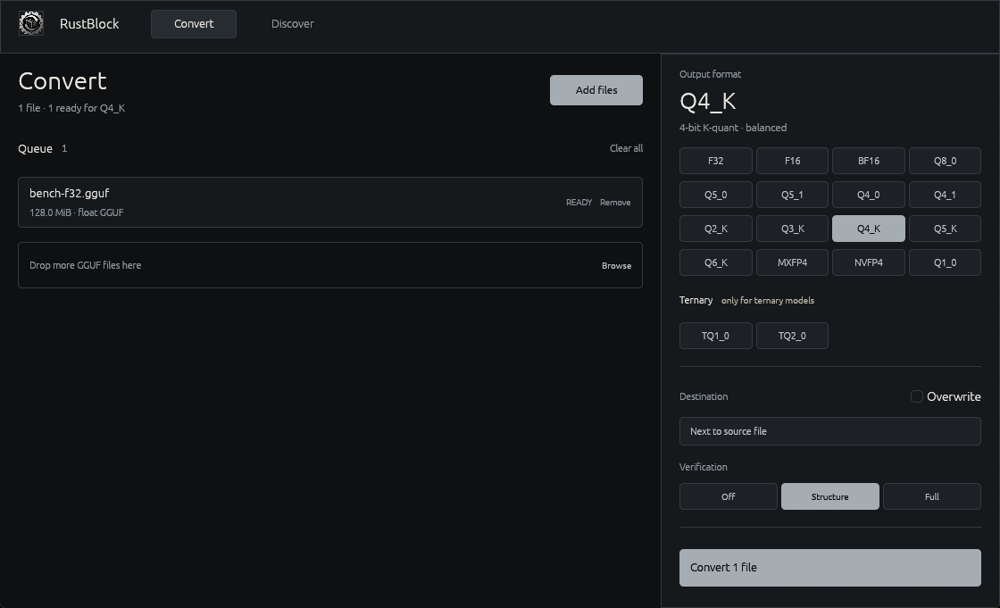

# RustBlock

<p align="center"></p>

**The native Swiss Army knife for GGUF models.** Reblock Prism ternary files, convert floats, quantize, verify and download from Hugging Face — from one steel-and-blocks desktop app. No Python, Node.js or terminal knowledge required.

RustBlock opens the source **read-only**, writes to a temporary file in the destination folder, verifies the result, and only then renames it into place. There is no telemetry and no upload of model data.

Conversion is **multicore and memory-bounded**: independent tensors run in parallel, and a single large tensor is split into codec-aligned spans that are decoded, quantized and re-encoded across all available cores without loading the whole model into RAM.

## What it can do

| Target | What it produces | Lossless? | Best for |
|---|---|---:|---|
| **Reblock** | Prism `PQ2_0` → standard `Q2_0` | **Yes** | Prism Ternary Bonsai files that stock llama.cpp / LM Studio cannot load |
| **F32** | 32-bit float | Yes, from float sources | Maximum compatibility and precision; very large |
| **F16** | 16-bit float | Yes, from F16 | The usual source for quantization; ~2 bytes per weight |
| **BF16** | bfloat16 | Yes, from float sources | Runtimes/training setups that prefer bfloat16 |
| **Q8_0** | 8-bit block quant | No, lossy | Near-original quality, much smaller than F16 |
| **Q5_0** | 5-bit block quant | No, lossy | Middle ground between Q8_0 and Q4_0 |
| **Q5_1** | 5-bit block quant with stored minimum | No, lossy | Older runtime compatibility |
| **Q4_0** | 4-bit block quant | No, lossy | Small and fast; classic legacy quant |
| **Q4_1** | 4-bit block quant with stored minimum | No, lossy | Slightly better than Q4_0 at a similar size |
| **Q2_K** | 2-bit K-quant | No, lossy | Very tight memory; noticeable quality loss |
| **Q3_K** | 3-bit K-quant | No, lossy | Compromise when Q4_K does not fit |
| **Q4_K** | 4-bit K-quant | No, lossy | The usual quality/size sweet spot |
| **Q5_K** | 5-bit K-quant | No, lossy | Better quality than Q4_K at a larger size |
| **Q6_K** | 6-bit K-quant | No, lossy | Near-F16 quality at a smaller size |
| **TQ1_0** | Ternary 1.69-bit | No, lossy | Tiny ternary models; experimental |
| **TQ2_0** | Ternary 2.06-bit | No, lossy | Tiny ternary models; experimental |
| **MXFP4** | 4-bit block float | No, lossy | Recent small/MoE runtimes; experimental |
| **NVFP4** | NVIDIA 4-bit block float | No, lossy | Recent NVIDIA runtimes; experimental |
| **Q1_0** | 1-bit | No, lossy | Extreme compression; experimental |

The K-quant targets use a **model-agnostic adaptive policy**. For `Q2_K` through `Q5_K`, tensors that are usually most sensitive — output projection, token embeddings and value projections — are kept one step higher (for example `Q6_K` inside a `Q4_K` conversion), while norms and unaligned rows stay `F32`. This is applied to every model; it is not the mixed `Q4_K_M` / `Q5_K_M` preset and it is not an importance-matrix calibration. IQ formats can be read as sources, but writing them requires an importance matrix and is intentionally not offered.

Ternary, MXFP4, NVFP4 and Q1_0 are **real native targets**, not placeholders: the output is a valid GGUF that the matching runtime can load. They are extremely lossy on a dense model. TQ1_0/TQ2_0 are meant for models trained or distilled for ternary weights; MXFP4/NVFP4 need a recent runtime; Q1_0 is a last-resort size experiment. Use `Full` verification when you want RustBlock to decode the output again and compare it.

### Lossless reblocking

Prism ML publishes Ternary Bonsai GGUFs in two layouts:

| Format | Type id | Block | Bytes / block | Support |
|---|---:|---:|---:|---|
| `PQ2_0` | 142 | 128 elems | 34 | Prism fork only |
| `Q2_0` | 42 | 64 elems | 18 | upstream llama.cpp / LM Studio |

Both use the same 2-bit ternary codec. RustBlock splits each 128-value block into two 64-value blocks with the original scale: no dequantization and no requantization, so every represented value is **bit-identical**.

## GUI




- **Convert** view: drag & drop one or many `.gguf` files, or browse with the native file picker.
- Choose any of the 19 targets with hover descriptions. Every format is visible at once — no collapsed “More formats” drawer. Float, legacy block, K-quant, FP4 and 1-bit are grouped in the normal grid; **TQ1_0/TQ2_0 have their own ternary section** with a separate warning because ternary is a different use case, not a normal requant.
- Compact queue with live speed/ETA, per-file progress, **stop after the current file** and per-file removal.
- Output next to each input or in a custom folder, with overwrite protection and duplicate-path checks.
- Choose `Off`, `Structure` or `Full` verification per batch; `Structure` is the default. The CLI exposes the same `--verify none|structure|full` levels for scripted checks.
- **Discover** view: opens on the most downloaded GGUF repositories, then search Hugging Face, paste a full `huggingface.co/author/model` link, sort by downloads, likes or update time, and open a repository to see its downloadable GGUF files and sizes.
- Downloads use a transfer panel with byte counts, percentage, smoothed speed, ETA, cancellation and resumable `.part` files. The panel stays visible on both Convert and Discover, and finished downloads are added to Convert automatically.
- Files whose names indicate an existing quantization (`Q4_K_M`, `Q8_0`, `IQ…`, `TQ…`, `MXFP4`, …) are marked **already quantized** before download. After conversion starts, the tensor types are checked as well. RustBlock warns that requantizing an already compressed model compounds the loss and that a virgin F16/BF16 release is the better source.
- **Only supported standalone GGUF models can be downloaded.** Non-GGUF files are hidden; importance matrices, projectors, adapters, split shards and PTQ1_0 containers are rejected. The download function repeats the check before the network request, then re-opens the finished file, verifies its tensor types and deletes it if the native engine cannot decode it.
- The interface is deliberately minimal: dark graphite, neutral steel and square controls, with one action per view. There is no log drawer, Activity panel, About window, card-metadata inspector or install-target UI.

Network access is used **only** when you search or download from Hugging Face. Local conversion works offline.

### Multicore conversion

RustBlock uses every available logical core by default. Set `RUSTBLOCK_THREADS` to leave headroom for inference or to benchmark:

```bash
RUSTBLOCK_THREADS=8 rustblock convert model-f32.gguf model-q5_k.gguf --to q5_k
```

The worker batch has a bounded memory budget (about 768 MiB of estimated peak buffers), so concurrency does not scale RAM with model size. Encoding and positional writes run in the same parallel batch, and a single tensor is split into enough block-aligned spans to keep every worker busy. On the development machine, a 128 MiB single-tensor F32 → Q5_K conversion took about **0.36–0.40 s with 1 thread** and **0.09–0.10 s with 16 threads** (≈4×; measurements vary with disk cache and CPU).

### Hugging Face token

Public repositories work without a token. For gated or private repositories, set a read token before launching:

```bash
export HF_TOKEN=hf_...
# Windows PowerShell: $env:HF_TOKEN = "hf_..."
```

The token is read from the environment and is never written to disk by RustBlock.

## Install / build

Requires Rust **1.92+**.

```bash
cargo build --release
```

Binaries:

- CLI: `target/release/rustblock` (`rustblock.exe` on Windows)
- GUI: `target/release/rustblock-gui` (`rustblock-gui.exe` on Windows)

Launch the GUI with one or more models:

```bash
cargo run -p rustblock-gui --release -- model-PQ2_0.gguf
```

## CLI

Inspect a GGUF (metadata, tensor histogram, reblock and native-conversion eligibility):

```bash
rustblock inspect model.gguf
```

Verify without writing anything:

```bash
rustblock verify model.gguf            # full PQ2_0 check when applicable
rustblock verify model.gguf --quick    # structure only
```

Convert with the lossless default:

```bash
rustblock convert model-PQ2_0.gguf model-Q2_0.gguf
```

Convert to another target:

```bash
rustblock convert model-F16.gguf model-Q4_K.gguf --to q4_k --verify structure
```

`--to` accepts:

```text
reblock | f32 | f16 | bf16 | q8_0 | q5_0 | q5_1 | q4_0 | q4_1 |
q2_k | q3_k | q4_k | q5_k | q6_k | tq1_0 | tq2_0 | mxfp4 | nvfp4 | q1_0
```

Other options:

```text
--force             overwrite an existing output file
--dry-run           validate and estimate without writing
--verify <level>    none | structure | full   (default: structure)
--json              machine-readable output
```

`reblock` is the default so existing scripts keep working. It is only valid for PQ2_0 sources; other targets work from any GGUF whose tensor types the native codec supports.

## Supported sources and limits

- GGUF **v3** files with `F32`, `F16`, `BF16`, `Q4_0`, `Q5_0`, `Q8_0`, K-quants, `Q2_0` and Prism `PQ2_0` tensors.
- `PTQ1_0` is rejected: it has no lossless upstream equivalent, and silent requantization would be misleading.
- Unknown tensor types are rejected rather than guessed.
- Raw **safetensors → GGUF is not supported**. That conversion needs model-specific architecture, tokenizer and chat-template handling, normally done by the model author's Python conversion script. RustBlock only converts existing GGUF files.
- Quantization is inherently lossy. `Full` verification catches structural errors and gross numerical damage; it is not a mathematical proof of model quality.
- The GUI runs one batch at a time. A stop request takes effect after the current file.
- Converted `Q2_0` reblocks need llama.cpp **b11555+** or LM Studio **2.56+**. Other targets need a runtime that supports the chosen GGUF type.
- No model weights are bundled.

## Tests

```bash
cargo test --workspace
```

Coverage includes lossless PQ2_0 reblocking, exact F16 conversion, Q4_K/Q8_0 layout and metadata, all target conversions, the adaptive protected-tensor policy, pure ternary output, parallel large-tensor conversion, alignment preservation, source immutability on error, dry-run, overwrite protection, download gating/validation and end-to-end metadata preservation.

## License

Apache-2.0. See [LICENSE](LICENSE) and [NOTICE](NOTICE).

RustBlock is an independent community tool. It is **not affiliated with, endorsed by, or sponsored by** Prism ML, Alibaba Cloud, Hugging Face, LM Studio or Ollama. “Bonsai” and “Ternary Bonsai” are products of Prism ML; Qwen is by Alibaba Cloud. All trademarks belong to their respective owners.
